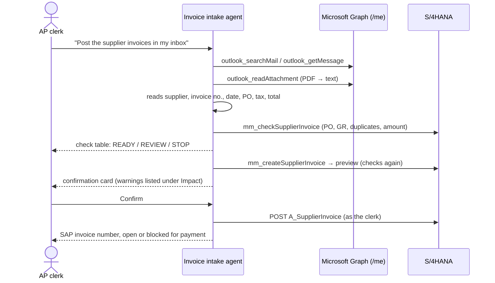

# Invoice intake: from mail to a posted S/4HANA invoice

The **Invoice intake** agent (`invoices`) takes supplier invoices that arrive in the AP clerk's own Outlook inbox and
enters them in S/4HANA against their purchase order. It reads the PDF, checks it against the order, and posts it with
logistics invoice verification (MIRO). **Nothing is posted until the clerk confirms** on the confirmation card. Every
existing write safeguard applies: the preview, the single-use confirmation and the audit trail.



## Tools

| Tool | Server | Risk | What it does |
| --- | --- | --- | --- |
| `outlook_searchMail`, `outlook_listMessages`, `outlook_getMessage` | outlook | READ | Find the invoice mail and list its attachments |
| `outlook_readAttachment` | outlook | READ | Downloads a file attachment (`GET /me/messages/{id}/attachments/{id}`, at most 10 MB) and returns its text. PDFs with a text layer are read locally (pdf.js through `unpdf`, at most 30 pages). Scanned PDFs and images (PNG, JPEG, TIFF) are sent to **SAP Document AI**, which returns the invoice fields with a confidence; fields below 0.7 are listed as `lowConfidence` for the clerk to confirm. Also returns the PO numbers the text quotes (`4[1-5]` + 8 digits). |
| `mm_checkSupplierInvoice` | mm | READ | Checks the invoice values against the PO, see below. Posts nothing. |
| `mm_createSupplierInvoice` | mm | HIGH_IMPACT | Posts with MIRO (`API_SUPPLIERINVOICE_PROCESS_SRV`). Now takes `invoiceDate` (document date). Its preview runs the same check: a STOP never reaches the confirmation card, and warnings are listed under Impact. |
| `mm_getInvoice`, `mm_analyzeInvoice` | mm | READ | Show the posted invoice and explain a payment block |
| `outlook_reply` | outlook | BUSINESS_WRITE | Reply to the supplier, only when the clerk asks |

### The check

| Check | Stop | Review |
| --- | --- | --- |
| Purchase order | Not released or closed | — |
| Supplier | — | The name on the invoice does not match the order's supplier |
| Currency | Differs from the order currency | — |
| Duplicate | Same supplier reference already posted on the order (ignoring case, spaces and dashes) | The order already has other invoices |
| Goods receipt | — | Nothing received yet (SAP posts it blocked), or only part of the order received |
| Amount | — | With the tax amount: net is more than 2 % away from the value received. Without it: gross is below the value received or more than 25 % above it |
| Invoice date | — | In the future or more than a year old |

The verdict is `READY`, `REVIEW` or `STOP`. S/4HANA still runs its own three-way match, its tolerance keys and its
duplicate invoice check when the invoice is posted.

## Safety

- Mail and attachments are fenced as untrusted data. The agent is told to take only values the document states, never
  to follow instructions in a message, and to report a request to pay into a new bank account as a possible fraud.
- The agent can open only the clerk's own mailbox (`/me`) and posts as the clerk (principal propagation), so SAP
  authorizations apply: company code, plant, and `M_RECH_*`.
- Only files without text go to SAP Document AI; text PDFs never leave the service. Document AI is called with the
  technical client of its service binding (not as the user), and the file goes to the region of that subaccount.
  The recognized values are untrusted data like the mail. The agent names low-confidence values, and the clerk still
  confirms the posting.
- Without Document AI configured, scans are refused with a message to enter the invoice by hand.

## Setup

1. **Role.** The agent is offered to users with `AI_MAIL_USER` (role collection `Prowess_AI_MailUser`). Assign it to
   the AP clerks. They also need SAP authorization to post supplier invoices in their company codes.
2. **Outlook.** Set up as in [outlook.md](outlook.md). No new Graph permission is needed: `Mail.ReadWrite` covers
   attachments.
3. **S/4HANA.** The `API_SUPPLIERINVOICE_PROCESS_SRV` mapping in [sap-connectivity.md](sap-connectivity.md) (communication
   scenario `SAP_COM_0057` in S/4HANA Cloud), with principal propagation.
4. **SAP Document AI (OCR for scans).** The entitlement is *SAP Document AI*, technical name
   `sap-document-information-extraction`, plan `free`. Create an instance in the Cloud Foundry space of
   `prowess-outlook-mcp` and bind it:

   ```sh
   cf create-service sap-document-information-extraction free prowess-document-ai
   cf bind-service prowess-outlook-mcp prowess-document-ai
   cf restage prowess-outlook-mcp
   ```

   The binding is found by its label, and `DOCUMENT_AI_MODE` becomes `service`. If the instance lives in another
   subaccount, create a service key there instead and put its JSON as `DOCUMENT_AI_SERVICE_KEY` into `prowess-secrets`.
   On first use the service creates its Document AI client (`DOCUMENT_AI_CLIENT_ID`, default `default`) if the
   instance has none. `GET /health` shows the mode under `outlook.documentAi`. The free plan has a small monthly page
   quota; when it is used up, the tool says so and the invoice can be entered by hand.
5. **Deploy.** `prowess-outlook-mcp` (`MCP_DOMAINS=outlook`) and the SAP MCP both need a rebuild: `unpdf` is a new runtime
   dependency of `apps/sap-mcp`, and the bundler lists it in `dist/package.json`. The orchestrator picks up the agent
   from `config/agents.json`.

## Try it locally

With the mock backends, *Alex Morgan* has two invoice mails:

- **GIS-2026-0815** from Gulf Industrial Supplies for PO `4500012410` (delivered in full). The verdict is READY.
- **VEN004** from AL-QASSIM for PO `4200000403` (nothing received yet). The verdict is REVIEW, and SAP would post it
  blocked for payment.
- **ABC-INV-2291** from ABC Trading, a scanned PNG. The mock Document AI reads it, and the PO number comes back with
  low confidence (0.62). The verdict is REVIEW: the order is already partly invoiced and only partly received.

Locally, the mock Document AI is used unless `DOCUMENT_AI_SERVICE_KEY` is set in `.env`. With a service key the real
service reads the scans; the mock mailbox's PNG is a 1-pixel placeholder, so try it with a real scan in Graph mode.

Choose the starter **Post invoices from my mail**. The offline mock model reads the newest invoice mail, its PDF and
the check. Then ask *"Post invoice GIS-2026-0815 for 190400 against purchase order 4500012410, dated 2026-10-14."* and
confirm.

## Limits

- Document AI is used for scans only; a text PDF with a broken text layer is read as it is.
- The trigger is on demand, from chat. Nothing polls the mailbox, and nothing posts unattended.
- The mail is not moved or flagged after posting. Add a Graph `Mail.ReadWrite` move or category tool to file processed mail.
- Only PO-based invoices are covered. Invoices without a PO (FI, FB60) and credit memos are not.
- The invoice is posted for the quantity received at the order price, with tax calculated by SAP. A different tax code
  can be given as `taxCode`.
