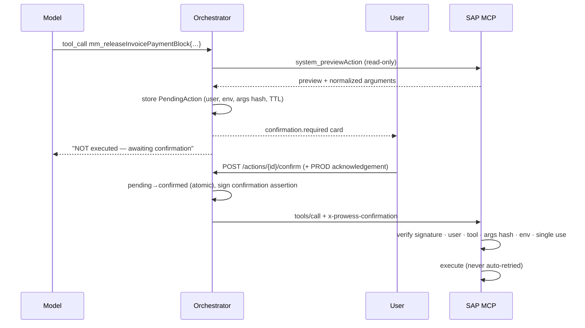

# MCP tool layer

The orchestrator is the MCP **client**. `prowess-sap-mcp` is an MCP **server** that uses the Streamable HTTP
transport in stateless mode (one short-lived server per request). The model chooses tools by intent, the orchestrator
authorizes them, and the MCP server executes them against SAP.

## Tools

| Domain | Tool | Risk | Notes |
| --- | --- | --- | --- |
| SD | `sd_getSalesOrder` | READ | Items, delivery / billing status, credit, delivery and billing blocks (VA01) |
| SD | `sd_getSalesOrderFlow` | READ | Order → delivery → goods issue → billing → accounting, with the outstanding step |
| SD | `sd_listOpenSalesOrders` | READ | Orders not completely delivered or billed, or blocked |
| SD | `sd_getDelivery` | READ | Outbound delivery, picking and goods issue status (VL01N) |
| SD | `sd_getBillingDocument` | READ | Billing document and its accounting document (VF01) |
| SD | `sd_createDelivery` | HIGH_IMPACT | Confirmation required. Outbound delivery for a sales order (VL01N) |
| SD | `sd_postGoodsIssue` | HIGH_IMPACT | Confirmation required. Reduces stock, posts cost of goods sold |
| SD | `sd_createBillingDocument` | HIGH_IMPACT | Confirmation required. Bills the goods-issued delivery (VF01) and posts it to accounting |
| SD | `sd_simulateSalesOrder` | READ | Price, availability and credit check for an order that is not saved |
| SD | `sd_createSalesOrder` | HIGH_IMPACT | Confirmation required. Standard order for one material (VA01) |
| SD | `sd_releaseCreditBlock` | HIGH_IMPACT | Confirmation required. Demo gateway only; not available through the released S/4HANA APIs |
| SD | `sd_reverseGoodsIssue` | HIGH_IMPACT | Confirmation required. Reverses the goods issue of a delivery (VL09) |
| SD | `sd_cancelBillingDocument` | HIGH_IMPACT | Confirmation required. Demo gateway only; cancel in SAP with VF11 |
| SD | `sd_createCreditMemoRequest` | BUSINESS_WRITE | Confirmation required. Request for the full value of a billing document |
| Credit | `credit_getCreditExposure` | READ | Credit limit, exposure, utilization, risk class |
| FI-AR | `ar_getAging` | READ | Open receivables per customer by days overdue |
| FI-AR | `ar_proposeClearing` | READ | Customers whose open items offset each other; nothing is cleared |
| FI-AP | `ap_getAging` | READ | Open payables by days overdue at a key date, with totals per supplier |
| FI-AP | `ap_listInvoiceApprovals` | READ | Supplier invoices with status, block and approver |
| FI-AP | `ap_getPaymentRunProposal` | READ | Payment run (F110) proposal: items to be paid and exceptions. The run is never released here |
| FI-AP | `ap_proposeClearing` | READ | Suppliers whose open items offset each other; nothing is cleared |
| FI-GL | `gl_searchGLAccounts` | READ | G/L account numbers by a part of the account name |
| FI-GL | `gl_getAccountActivity` | READ | Debit and credit postings per G/L account for a period range |
| FI-GL | `gl_listGRIRCases` | READ | Purchase order items with an open GR/IR balance, with root cause |
| FI-GL | `gl_getBankReconciliation` | READ | Open bank statement items per house bank account |
| FI-GL | `gl_getDepreciationOverview` | READ | Posted and not yet posted depreciation per fixed asset |
| FI-GL | `gl_clearOpenItems` | HIGH_IMPACT | Confirmation required. Clears the open items of one customer or supplier that offset to zero (F-32 / F-44) |
| FI-GL | `gl_postJournalEntry` | HIGH_IMPACT | Confirmation required. Balanced manual G/L entry (FB50) |
| Credit | `credit_listCreditBlockedOrders` | READ | Sales orders blocked by the credit check |
| FI-AR | `ar_requestIncomingPayment` | BUSINESS_WRITE | Confirmation required. Creates a payment request (F-28); nothing is posted yet |
| FI-AP | `ap_requestOutgoingPayment` | BUSINESS_WRITE | Confirmation required. Creates a payment request (F-53); nothing is posted yet |
| FI-GL | `gl_listPaymentRequests` | READ | Approval queue: waiting, approved, posted, rejected |
| FI-GL | `gl_approvePaymentRequest` | HIGH_IMPACT | Confirmation required. SAP refuses approval by the creator of the request |
| FI-GL | `gl_rejectPaymentRequest` | BUSINESS_WRITE | Confirmation required |
| FI-GL | `gl_postPaymentRequest` | HIGH_IMPACT | Confirmation required. Posts an approved request as a payment on account (DZ / KZ) |
| FI-AR | `ar_getCustomer` | READ | Customer master, blocks, open and overdue receivables |
| FI-AR | `ar_listCustomerOpenItems` | READ | Customer line items, open / cleared / all (FBL5N) |
| FI-AR | `ar_listOverdueReceivables` | READ | Overdue customer items across a company code |
| FI-AP | `ap_getVendor` | READ | Vendor exposure (open/overdue) |
| FI-AP | `ap_getPaymentStatus` | READ | Paid / open / blocked |
| FI-AP | `ap_listVendorOpenItems` | READ | Supplier line items, open / cleared / all (FBL1N) |
| FI-AP | `ap_listInvoicesDue` | READ | Open supplier items due for payment by a date |
| FI-GL | `gl_getGLBalance` | READ | Debit/credit/balance |
| FI-GL | `gl_getAccountingDocument` | READ | Journal entry with debit and credit lines |
| FI-GL | `gl_listGRIROpenItems` | READ | GR/IR clearing account, balanced per purchase order |
| MM | `mm_getPurchaseOrder`, `mm_getPurchaseRequisition`, `mm_getGoodsReceipt`, `mm_getVendorDetails` | READ | |
| MM | `mm_getMaterialStock` | READ | Stock by plant and storage location |
| MM | `mm_getInfoRecords` | READ | Sources of supply: supplier, price, delivery time, last PO |
| MM | `mm_getInvoice` | READ | Header, payment block, verification issues (MIRO) |
| MM | `mm_analyzeInvoice` | READ | Invoice vs PO vs goods receipts → findings and next steps |
| MM | `mm_listBlockedInvoices` | READ | Invoices blocked for payment (MRBR worklist) |
| MM | `mm_getPurchaseOrderFlow` | READ | Order → goods receipt → supplier invoice, with open quantities and the outstanding step |
| MM | `mm_createPurchaseRequisition` | BUSINESS_WRITE | Confirmation required. Requisition for a material (ME51N) |
| MM | `mm_createPurchaseOrder` | HIGH_IMPACT | Confirmation required. Standard order; price from the info record unless given (ME21N) |
| MM | `mm_postGoodsReceipt` | HIGH_IMPACT | Confirmation required. Receives the open quantity of a purchase order (MIGO, movement 101) |
| MM | `mm_createSupplierInvoice` | HIGH_IMPACT | Confirmation required. Invoice for the received quantity (MIRO); SAP blocks it for payment on a variance |
| MM | `mm_reverseGoodsReceipt` | HIGH_IMPACT | Confirmation required. Reverses the latest goods receipt of a purchase order |
| MM | `mm_reverseSupplierInvoice` | HIGH_IMPACT | Confirmation required. Reverses a posted supplier invoice (MR8M) |
| MM | `mm_addInvoiceNote` | LOW_RISK_WRITE | Confirmation required |
| MM | `mm_releaseInvoicePaymentBlock` | HIGH_IMPACT | Confirmation required; SAP release authorization |
| PM | `pm_getEquipment`, `pm_getNotification`, `pm_getWorkOrder`, `pm_getMaintenanceHistory` | READ | |
| SF | `sf_getMyProfile`, `sf_getEmployee` | READ | SuccessFactors employee profile. The e-mail address is shown on the card and not sent to the model |
| SF | `sf_searchEmployees` | READ | Employees by a part of their name |
| SF | `sf_getDirectReports`, `sf_getReportingLine` | READ | Team of a manager; chain of managers above an employee. Default: the current user |
| SF | `sf_getJobHistory` | READ | Effective-dated job information (EmpJob) |
| SF | `sf_getTimeOff` | READ | Time account balances and upcoming absences with their approval status |
| SF | `sf_getTeamOverview` | READ | Headcount, who is out today, open positions and the team. Figures the tenant does not provide are left out |
| SF | `sf_showEmployeeMap` | READ | Employees on a map by work location, drawn as hotspots. See [vendor-map.md](vendor-map.md#employee-map) |
| SF | `sf_listEmployeeLocations` | READ (internal) | Hidden from models; feeds the employee map |
| SF | `sf_listTimeTypes` | READ | The kinds of time off with their codes |
| SF | `sf_requestTimeOff` | BUSINESS_WRITE | Confirmation required. Leave request for the current user only; SuccessFactors starts its approval workflow |
| SF | `sf_listApprovals` | READ | Workflow requests waiting for the user's decision |
| SF | `sf_approveRequest`, `sf_declineRequest` | BUSINESS_WRITE | Confirmation required. Decides one workflow request; declining needs a reason |
| SF | `sf_listBusinessCases`, `sf_runBusinessCase`, `sf_describeEntity` | READ | Power users only (`AI_POWER_USER`). The top cases of the 13 SuccessFactors modules; see below |
| SF | `sf_listEntities`, `sf_queryEntity` | READ | Governed generic read: allow-listed entities and fields only, protected fields redacted |
| Shared | `shared_getUserContext`, `shared_getSystemInformation`, `shared_searchBusinessObject` | READ | |
| Shared | `shared_showFioriGuide` | READ | Opens a Fiori app in the pane beside the conversation, where the agent then reads, points, types and clicks (`fiori_*`, orchestrator tools). Reads nothing from SAP itself. See [sap-connectivity.md](sap-connectivity.md#fiori-pane) |
| System | `system_previewAction` | READ (internal) | Hidden from models; builds the confirmation card |

Every tool publishes metadata in `_meta`: `prowess/risk`, `prowess/domain`, `prowess/targetSystem`,
`prowess/operation`, `prowess/statusLabel`, plus MCP `annotations` (`readOnlyHint`, `destructiveHint`).

## Tool result contract

```jsonc
{
  "data":       { "summary": "…", "findings": ["…"], "nextSteps": ["…"] }, // → model, fenced as untrusted
  "components": [{ "type": "invoice", "data": { … } }],                    // → UI, re-validated by the orchestrator
  "source":     { "system": "S4-PRD", "objectType": "SupplierInvoice", "objectId": "5100012345/2026", "retrievedAt": "…", "mock": false },
  "followUps":  [{ "label": "Check related PO", "prompt": "…" }],         // → suggested prompts, never executions
  "outputs":    { "delivery": "80000258" }                                // → values later steps of a workflow run can use
}
```

## Write workflow



## Splitting domains into services

Tool domains follow SAP modules: `sd`, `credit`, `ar`, `ap`, `gl`, `mm`, `pm`, `sf` and `shared`. The domain modules are
independent. To extract accounts payable:

1. Deploy `apps/sap-mcp` a second time as `prowess-mcp-ap` with `MCP_DOMAINS=ap` (and remove `ap` from the original).
2. Configure the orchestrator with
   `MCP_SERVERS=[{"id":"ap","url":"https://…/mcp"},{"id":"sap","url":"https://…/mcp"}]`.

The former `fico` domain is still accepted in `MCP_DOMAINS` and expands to `ar,ap,gl,credit`.

No other code changes are needed. Tool names are unique across servers (duplicates are rejected at discovery).

## SuccessFactors

The `sf` domain reads SAP SuccessFactors through its own gateway (`apps/sap-mcp/src/sf`), with the same tool
contract, caller authentication and metadata as the S/4HANA domains. Deploy it as its own service
(`MCP_DOMAINS=sf`, `SF_MODE=odata`) and add it to `MCP_SERVERS`; see [sap-connectivity.md](sap-connectivity.md#successfactors).
Its only writes are the two workflow decisions, which go through the confirmation card like every other write.
In PROD it is never served from the mock.

### Business cases

`apps/sap-mcp/src/sf/business-cases.ts` holds the top read cases of each SuccessFactors module (58 in all, at most
five per module), ported from the business-case library of the `SAP_SF_MCP_V4` repository. A case names one entity
and at most one value the user supplies; `sf_runBusinessCase` runs it and shows the records as a table.

- **Power users only.** The three tools declare `requiredRole: AI_POWER_USER`. The orchestrator does not offer them
  to anyone else, and the MCP server refuses them for a principal without the role.
- **Field names are a starting point.** They come from the API reference, not from a tenant. A case reads without
  naming its fields and shows what the tenant returns, its own columns first, at most ten.
- **Self-correcting.** When SuccessFactors rejects a filter, its reason is passed on; `sf_describeEntity` returns the
  tenant's real field names, and the case can be run again with `filters`. An entity the tenant does not have is
  reported as a module that is not in use.
- **Protected fields are never shown**, whatever the tenant returns: identity documents, bank details, secrets and
  special categories of personal data (`isProtectedField`). They cannot be used in a filter either.
- **Read-only.** Cases that change data in the library are left out. The five Learning cases are listed as not
  available: Learning has its own API, which the `SF_ODATA` destination does not reach.

To add or correct a case, edit the catalog; no tool changes.

The same pattern adds Ariba or other servers.
