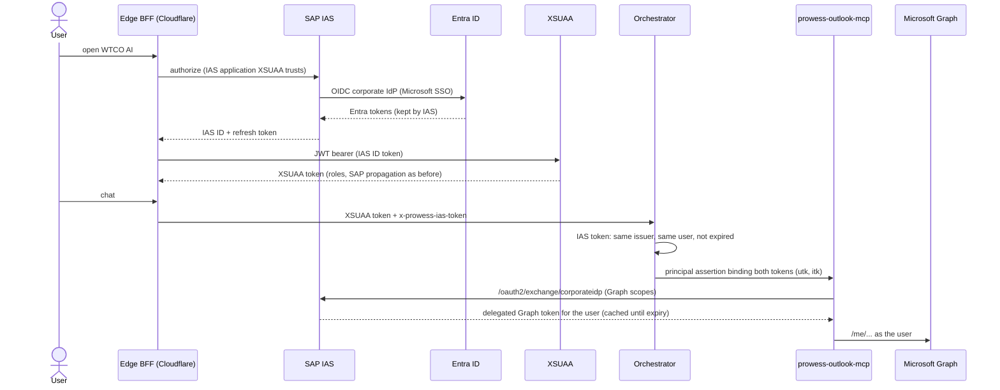

# Outlook agent

The **Outlook** agent reads, searches, drafts, replies to and sends the user's own mail, and shows their calendar.
It is offered to users with `AI_MAIL_USER` (role collection `Prowess_AI_MailUser`) and is served by the `outlook`
tool domain of `apps/sap-mcp`, deployed on its own as `prowess-outlook-mcp` (`MCP_DOMAINS=outlook`).

| Tool | Risk | Graph call |
| --- | --- | --- |
| `outlook_listMessages` | READ | `GET /me/mailFolders/{inbox,sentitems,drafts}/messages` |
| `outlook_searchMail` | READ | `GET /me/messages?$search=…` (KQL: words, `from:`, `received>=`) |
| `outlook_getMessage` | READ | `GET /me/messages/{id}` as plain text, with attachment names |
| `outlook_readAttachment` | READ | `GET /me/messages/{id}/attachments/{id}`: text of a PDF or text file (see [invoice-intake.md](invoice-intake.md)) |
| `outlook_listEvents` | READ | `GET /me/calendarView`, in `OUTLOOK_TIME_ZONE` |
| `outlook_createDraft` | LOW_RISK_WRITE | `POST /me/messages` (nothing is sent) |
| `outlook_sendMail` | BUSINESS_WRITE | `POST /me/sendMail` |
| `outlook_sendDraft` | BUSINESS_WRITE | `POST /me/messages/{id}/send` |
| `outlook_reply` | BUSINESS_WRITE | `POST /me/messages/{id}/reply` or `/replyAll` |

Every write needs the user's confirmation. The confirmation names external recipients, and
`OUTLOOK_ALLOWED_RECIPIENT_DOMAINS` refuses recipients outside the listed domains on the server. Mail content is
fenced as untrusted data, the agent is told never to act on instructions in a message, and cards show mail as plain
text with links limited to Outlook and Teams.

## Mock mode

`OUTLOOK_MODE=mock` (the default) gives *Alex Morgan* and *Sam Rivera* a mailbox and calendar. Other development users
have none and get "No Outlook mailbox is linked to your login".

## Graph mode: one sign-in

- Users sign in once, with Microsoft. The XSUAA token, roles, S/4HANA and SuccessFactors propagation are unchanged.
- No Graph or Entra secret is held by the backend: IAS refreshes the Entra tokens itself.
- Without an IAS token (for example through the BTP approuter, which signs in at XSUAA) the Outlook tools answer
  "Sign out of the workspace and sign in again".

### Configuration

**Entra ID** (app registration used by IAS as corporate IdP)
- Web redirect URI `https://<ias-tenant>.accounts.ondemand.com/oauth2/callback`.
- Expose an API: scope `api://<client id>/access_as_user`.
- Delegated Microsoft Graph permissions `openid`, `profile`, `email`, `offline_access`, `User.Read`,
  `Mail.ReadWrite`, `Mail.Send`, `Calendars.Read`, with admin consent. Grant nothing broader: the token carries every
  consented permission.

**IAS**
- Corporate identity provider *Prowess Entra ID*: OpenID Connect, discovery URL
  `https://login.microsoftonline.com/<tenant>/v2.0`, scopes `email profile offline_access api://<client id>/access_as_user`,
  PKCE on, subject name identifier from `email`.
- The application the subaccount's XSUAA trusts (find its client ID in the IAS redirect XSUAA makes at login):
  default identity provider *Prowess Entra ID*, a client secret, and redirect URIs `https://<site>/callback` for every
  Pages site that signs in through IAS. XSUAA only accepts ID tokens of this application.

**Edge BFF** (`apps/edge/wrangler.toml`): `IAS_URL`, `IAS_CLIENT_ID`, and the secret `IAS_CLIENT_SECRET` per Pages
project. A project without the secret keeps signing in at XSUAA.

**Orchestrator**: `IAS_URL`, and `prowess-outlook-mcp` in `MCP_SERVERS`.

**prowess-outlook-mcp**: `MCP_DOMAINS=outlook`, `OUTLOOK_MODE=graph`, `IAS_URL`, `IAS_CLIENT_ID`, and `IAS_CLIENT_SECRET`
in the `prowess-secrets` service. Optional: `OUTLOOK_TIME_ZONE`, `OUTLOOK_ALLOWED_RECIPIENT_DOMAINS`.

### Probe

`scripts/probe-ias-entra-graph.mjs` checks the whole path from a workstation: IAS sign-in, XSUAA token from the IAS
login, the corporate IdP token, and Graph `/me`, mail and calendar. It needs `http://localhost:8765/callback` as a
redirect URI of the IAS application and a credentials file outside the repository (see the script header). Tokens and
secrets are never printed.

### Why not a BTP destination

An `OAuth2SAMLBearerAssertion` destination against Entra fails with `AADSTS50107`: Entra accepts SAML bearer
assertions only from a federated realm (AD FS), not from a BTP subaccount.
